# Grailio walkthrough

The full app flow on a phone (375 px), in demo mode. Demo mode simulates the chain in the browser: the same rules as the contracts, no wallet needed. Every screen below comes from one run, in order.

**The idea in one line:** packs are presold before the coin exists, the presale buyers own the first prizes, and the coin's trading tax keeps a stock pool full. Every card holds a real tokenized stock (bStocks priced by Atlas) that you can redeem.

Contents: [Start](#1-start) · [Launch a coin](#2-launch-a-coin) · [Presale](#3-presale) · [Launch](#4-launch) · [Trading tax fills the pool](#5-trading-tax-fills-the-pool) · [Collection: stake, claim, redeem](#6-collection-stake-claim-redeem) · [Profile](#7-profile) · [Trade](#8-trade) · [Classic packs](#9-classic-packs-no-coin) · [Launch without a coin](#10-launch-without-a-coin)

---

## 1. Start

| | |
|---|---|
| 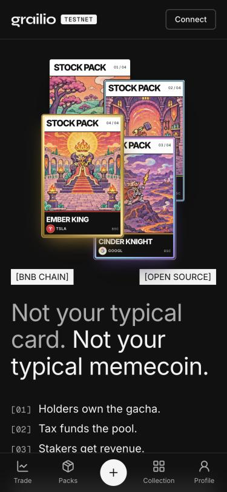 | **Home.** The pitch: holders own the gacha, tax funds the pool, stakers get revenue. |
| 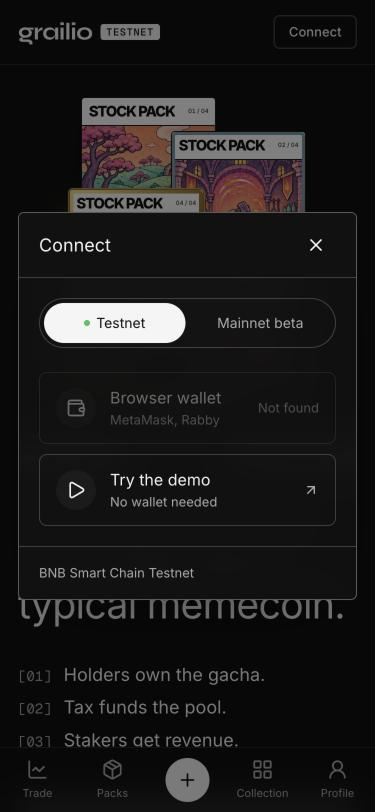 | **Connect.** Pick testnet or mainnet, then a browser wallet, or *Try the demo* (no wallet). The rest of this walkthrough uses the demo. It starts you with 0.5 BNB and 500 USDT. |

## 2. Launch a coin

The centre **+** button opens Launch. A creator picks *With coin* (a memecoin and its packs) or *Without coin* (packs only, see [step 10](#10-launch-without-a-coin)).

| | |
|---|---|
| 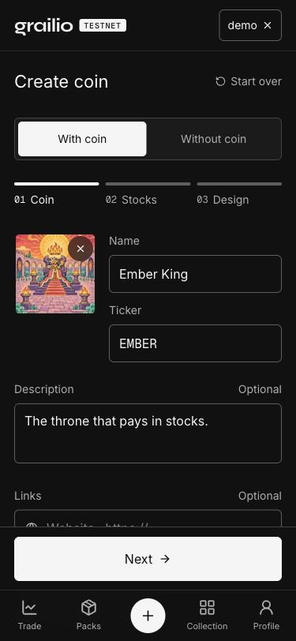 | **Coin.** Picture, name and ticker, like any launchpad. |
| 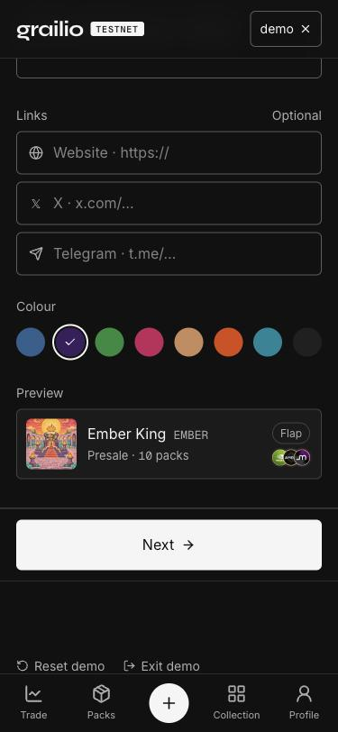 | **Details.** Optional links and a colour. The preview shows the coin, its launchpad (Flap) and the 10-pack presale. |
| 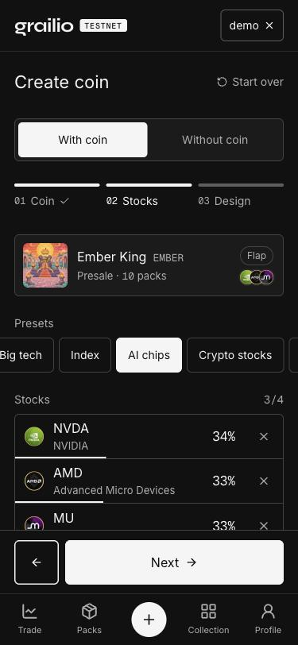 | **Stocks.** The basket the cards draw from, each with its weight bar. Here it's the *AI chips* preset: NVDA, AMD and MU. |
| 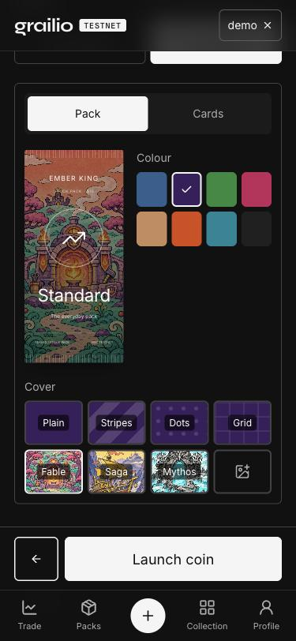 | **Design: pack.** Use the defaults or customize the pack colour and cover (here the Fable art). |
| 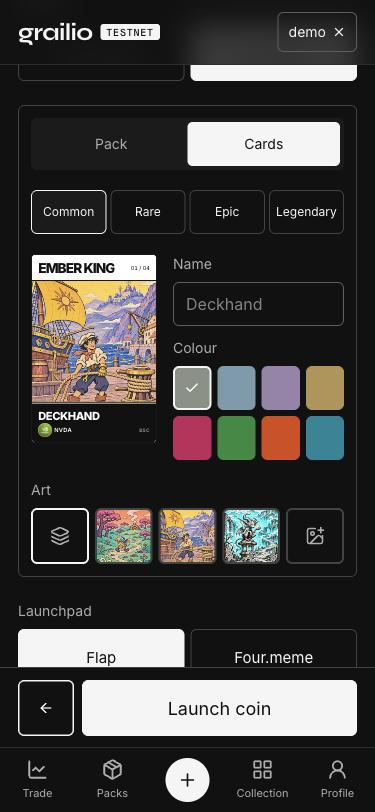 | **Design: cards.** One artwork per rarity. |

## 3. Presale

The coin doesn't exist yet. Its first 10 packs are sold as a presale.

| | |
|---|---|
| 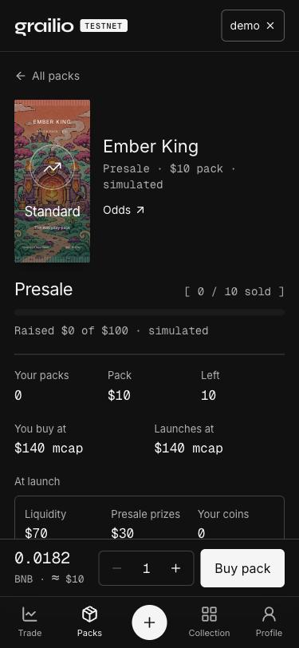 | **Presale open.** 0 / 10 sold. *You buy at* and *Launches at* show the same market cap ($140): supply splits 50 / 50 between presale buyers and the pool, so presale buyers pay exactly the launch price. *At launch* shows where the raise goes: 70 % liquidity, 30 % presale prizes. |
| 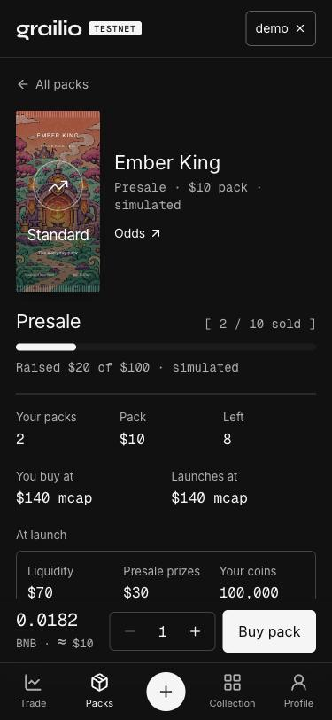 | **Bought 2 packs.** 2 / 10. Each presale pack also earns coins at launch (100,000 here). |
| 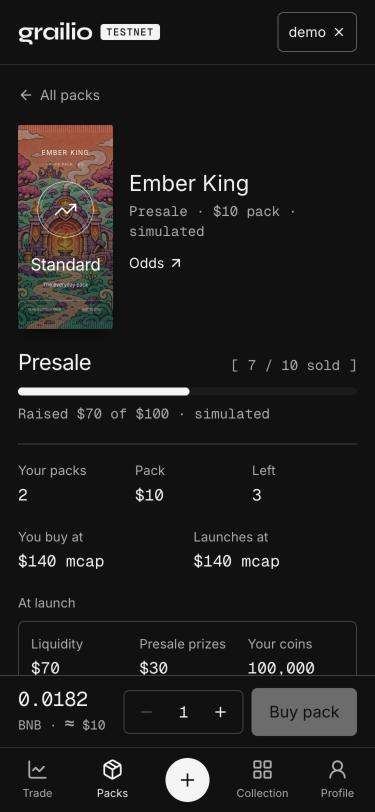 | **Simulate other buyers.** In the demo, other wallets fill the rest. |

## 4. Launch

| | |
|---|---|
| 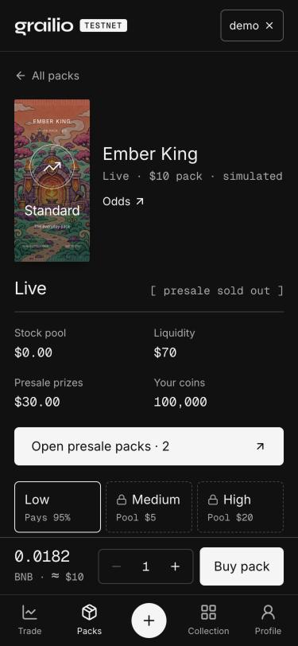 | **Live.** The presale sold out, so the coin launched with $70 liquidity and $30 of presale prizes. The stock pool starts empty. Only *Low* packs are open (they always pay 95 %). Medium and High stay locked until the pool can cover their top prize. |
| 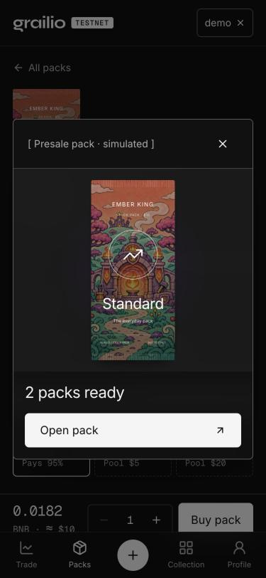 | **Open presale packs.** Presale packs share the $30 prize reserve, and it pays out in full. |
| 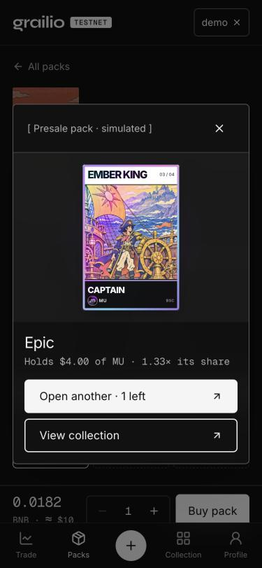 | **Reveal.** An Epic card holding $4.00 of MU, 1.33× its share of the reserve. The other pack was a Common at 0.78×. |

## 5. Trading tax fills the pool

Each trade of the coin pays a tax. It splits **50 % stock pool · 30 % card stakers · 15 % creator · 5 % platform**.

| | |
|---|---|
| 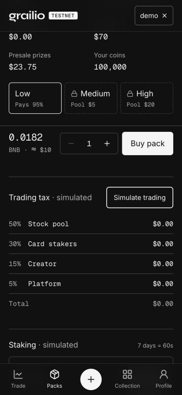 | **Before trading.** Nothing collected yet. |
| 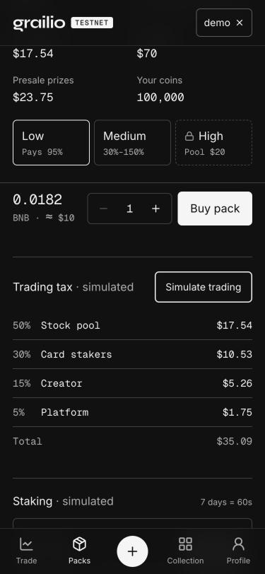 | **Simulate trading.** Once the pool reaches $5, Medium unlocks (pays 30 %–150 %). |
|  | **All tiers.** At $20, High unlocks too (10 %–300 %). Medium and High both average 90 %. The pool always holds enough for the best prize of every pack sold. |
| 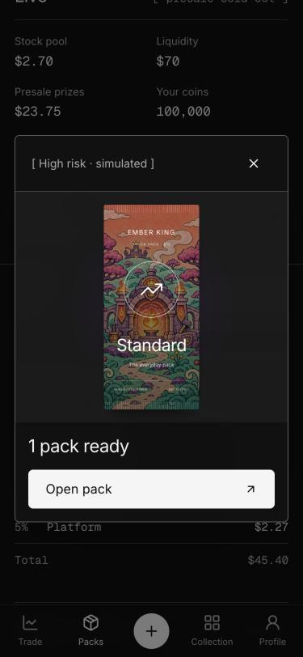 | **Buy High.** Buying sets aside the top prize ($20) from the pool. |
| 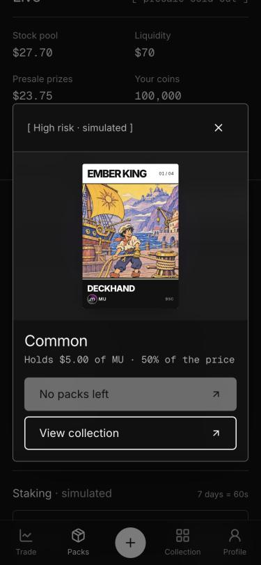 | **Reveal.** This roll paid 50 %: a $5.00 MU card. The unused reserve and the pack price go back into the pool, so it grows. |

## 6. Collection: stake, claim, redeem

| | |
|---|---|
| 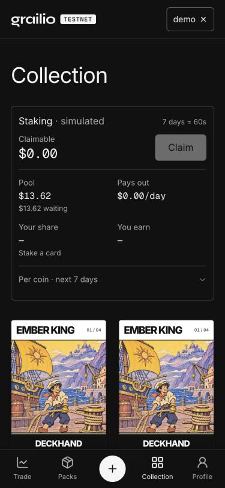 | **Collection.** Your cards, with the stakers' share of the tax (30 %) waiting for someone to stake. |
| 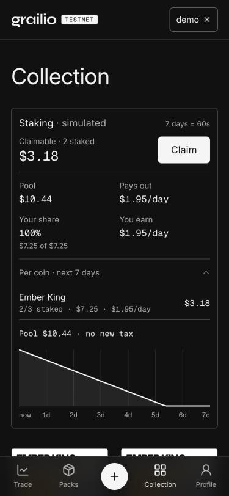 | **Staking.** Two cards staked. Rewards stream over 7 days (60 s in the demo), split by card value. The chart shows the pool running out with no new tax. *Claim* pays out what has streamed so far. |
| 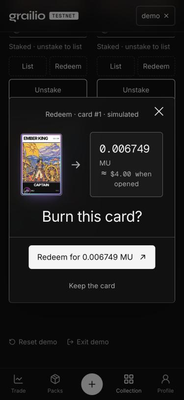 | **Redeem.** Burn a card for the stock inside it: here 0.006749 MU. Staked cards must be unstaked first. |

## 7. Profile

| | |
|---|---|
| 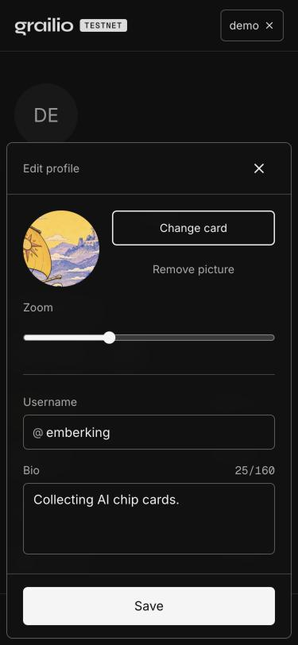 | **Edit profile.** Username, bio, and any card you own as the avatar. |
| 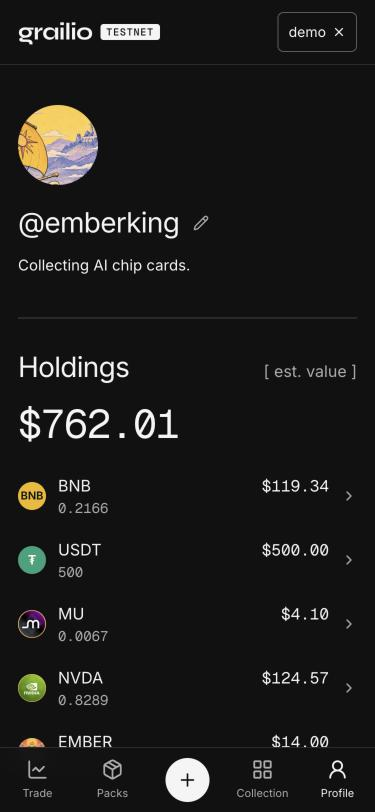 | **Profile and holdings.** BNB, USDT, the redeemed MU, and 100,000 EMBER from the presale, valued at the launch price ($14). |

## 8. Trade

| | |
|---|---|
| 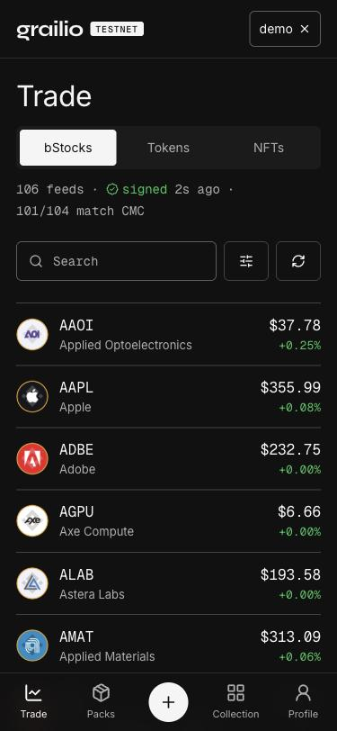 | **bStocks.** 106 tokenized stocks with signed Atlas prices, checked against CoinMarketCap. |
| 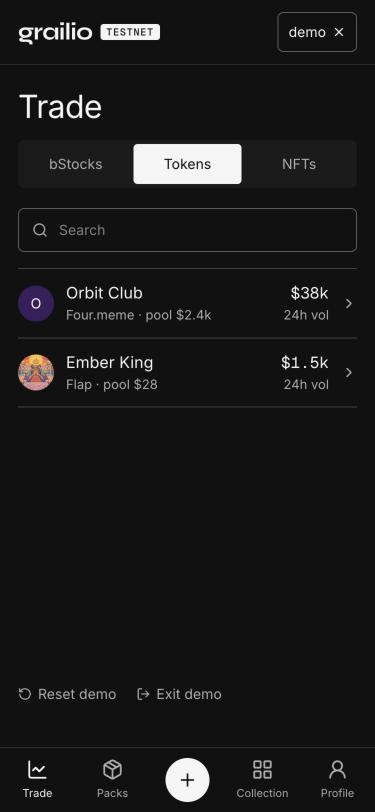 | **Tokens.** Coins launched with packs. Ember King shows its simulated pool and volume. |
| 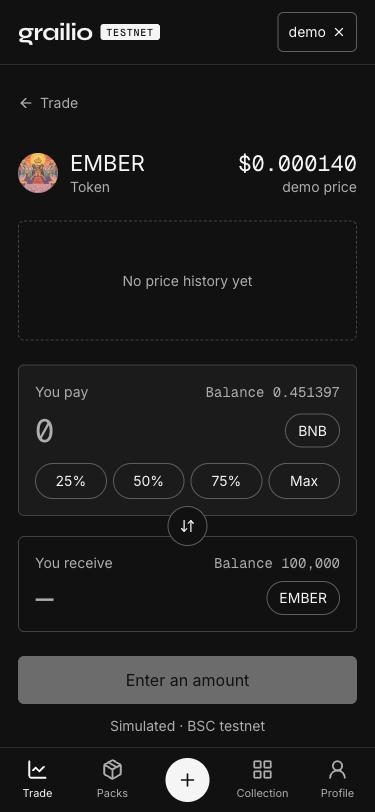 | **Trade a coin.** Buy or sell EMBER with BNB. |
| 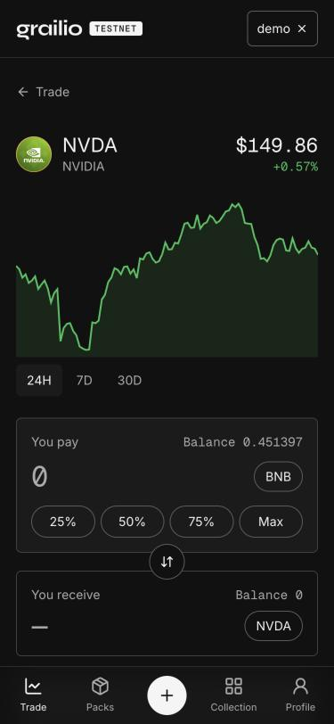 | **Trade a stock.** NVDA with a live chart. |
| 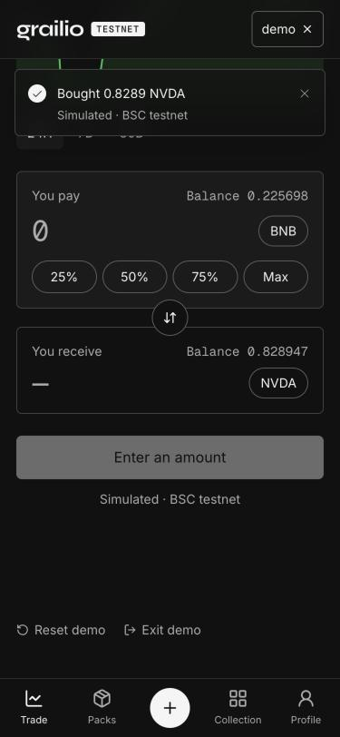 | **Bought.** Half the BNB swapped for 0.8289 NVDA. |

The **NFTs** tab is a card marketplace: list your cards or buy someone else's.

## 9. Classic packs (no coin)

| | |
|---|---|
| 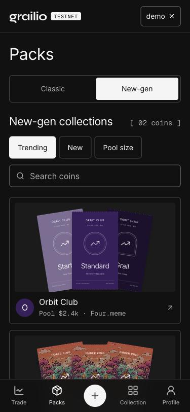 | **New-gen.** Coin-backed collections, sorted by trending, newest or pool size. |
| 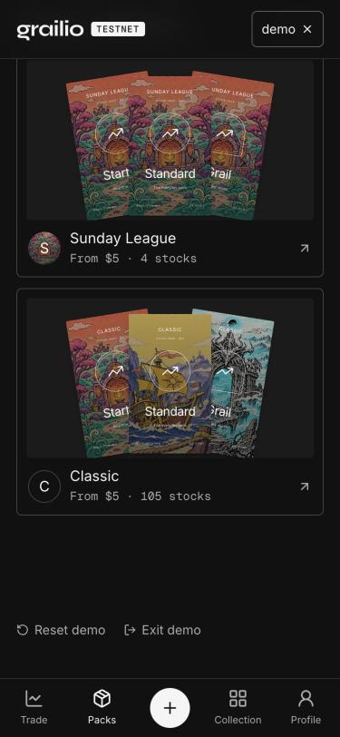 | **Classic.** Collections with no coin, in the same card style: the built-in Classic line draws from all 105 stocks. |
| 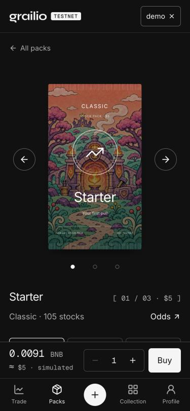 | **Classic shop.** Draws from all 105 stocks. Same tiers: Low, Medium, High. |
| 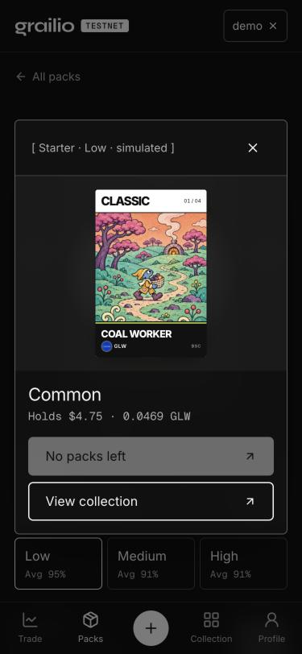 | **Reveal.** A Common holding $4.75 of GLW. |

## 10. Launch without a coin

| | |
|---|---|
| 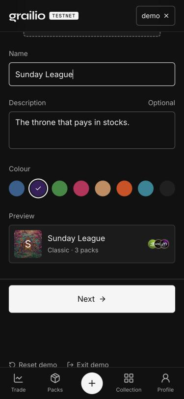 | **Without coin.** Just a collection: name, cover, colour. No ticker, presale or tax. |
| 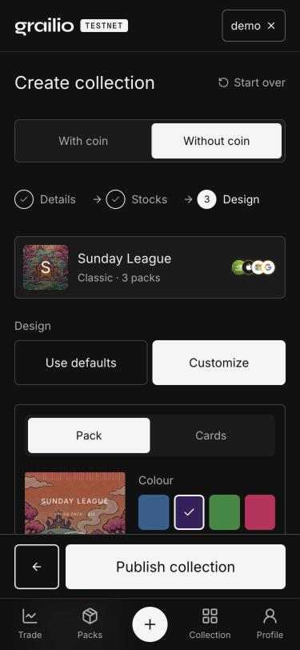 | **Stocks and design.** The *Big tech* basket with custom art. |
| 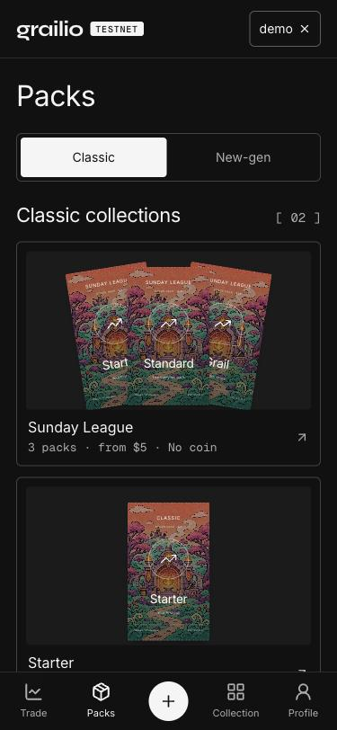 | **Published.** Sunday League is listed first under Classic. |

---

### On-chain

The same mechanics run on BSC testnet as contracts: `PackVault` (pool, presale reserve, tiers, staking stream, redeem), a Flap launcher (`PackLauncher`, `PackVaultFactory`) and an OpenFour fork (`OpenFourPackVault`, `PackMigrateModule`). The Foundry suite (40 tests, including fork tests of the full journey in BNB and in Flap's testnet USD) is in `contracts/`.
